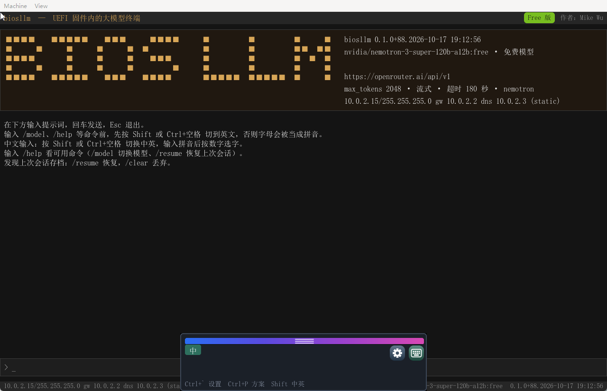
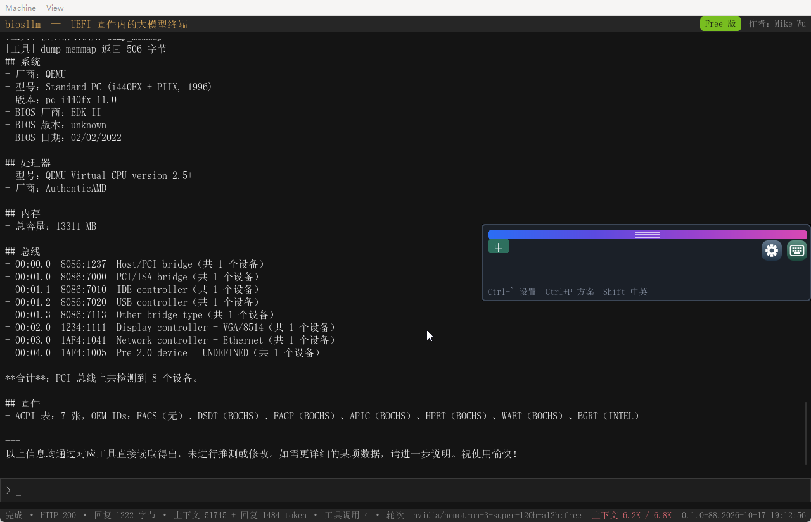

# biosllm — UEFI 固件内的大模型终端

> **biosllm** 是一款运行在 UEFI 固件环境里的对话式硬件助手：不需要操作系统、不需要驱动安装包，固件一启动就是一个中文对话框，能问这台机器的事。模型在云端，工具在固件里——它把固件自己的接口做成 13 个只读工具交给模型，模型决定调哪个，程序回灌固件的真实输出。
>
> **License**：专有软件，不是开源软件。Free 版**免费授权个人用户**用于个人、非商业用途；商业用途与 Pro 版请联系作者（Mike Wu，mikewuping@163.com）。





## 它能做什么

- **先于操作系统看清一台机器**：机器进不了系统、或还没有系统时，固件是唯一能运行的东西。ACPI 表、PCI 设备树、SMBIOS、内存映射、块设备、网卡与 IP、EFI 变量，全部现场可读。
- **答案来自这一台机器，不是型号推测**：每个工具返回固件当场给出的原始数据；取不到就报"取不到"，不编造。
- **中文提问**：配合随包的 `uime.efi` 输入法，敲拼音选字即可，宿主程序一行不用改。
- **模型可换**：DeepSeek、OpenRouter 免费池、本地 mock 都行，一个 JSON 文件改一行。

## 下载与启动

到 [Releases](../../releases) 下载：

| 文件 | 用途 |
|---|---|
| `biosllm-boot-0.1.0.105.iso` | 用 Rufus 写入 U 盘（「ISO 镜像模式」），或刻成光盘，开机选 UEFI 启动 |
| `biosllm-usb-0.1.0.105.zip` | 解压到 FAT32 U 盘根目录（**推荐**：U 盘可写，能填自己的 api_key） |
| `biosllm.efi` / `uime.efi` | 只要程序本体时单独取用 |
| `biosllm-manual.html` | 产品手册（单文件，图文，12 节） |

启动路径：固件 → UEFI Shell（随包）→ 自动执行 `startup.nsh` → 加载输入法 → 进入 biosllm。Secure Boot 打开的机器需要先在固件里关闭，或给应用签名。

**第一次使用必须做的一件事**：把 `biosllm-usb-*.zip` 解压到 U 盘后，用记事本打开根目录的 `biosllm.json`，把 `api_key` 从 `sk-REPLACE_ME` 换成你自己的密钥。光盘与 ISO 是只读介质，盘上的配置改不了——这也是推荐 U 盘 ZIP 的原因。

## 配置

```json
{
  "provider": "deepseek",
  "providers": {
    "deepseek": {
      "format": "openai",
      "base_url": "https://api.deepseek.com",
      "api_key": "sk-你的密钥",
      "model": "deepseek-flash"
    }
  },
  "request": { "max_tokens": 2048, "stream": true, "timeout_sec": 180 },
  "system": "你是 biosllm，运行在 UEFI 固件里的助手。回答简洁。",
  "allow_shell": false
}
```

| 字段 | 说明 |
|---|---|
| `provider` | 默认用 `providers` 里的哪一个；运行中可用 `/model` 临时切换 |
| `format` | `openai` 或 `anthropic`。**只有 openai 形状支持工具调用** |
| `api_key` | 明文密钥，只放在你自己的 U 盘上，不要交给别人 |
| `allow_shell` | 是否允许 `run_command` 执行 UEFI Shell 命令，默认 `false` |

https 需要根证书：DeepSeek 用 DigiCert Global Root G2（`certs/` 已带）；换其他服务时把对端证书链的根导出成 DER 放进 `certs/` 即可。

## 工具清单（13 个，全部只读）

| 工具 | 返回什么 |
|---|---|
| `list_dir` / `read_file` | 启动卷上的目录与文本文件 |
| `read_env` | EFI 变量：`BootOrder`、`SecureBoot`、`SetupMode`… |
| `read_skill` | 技能全文 |
| `dump_smbios` | BIOS 厂商版本、整机型号、内存条 |
| `dump_memmap` | EFI 内存映射 |
| `dump_acpi` | ACPI 表目录（签名、长度、修订、OEM id） |
| `dump_pci` | PCI 设备树：地址、厂商设备 ID、类别 |
| `read_mem` | 任意物理地址的十六进制转储（16 字节一行，左 hex 右 ASCII），首行标注所属内存区 |
| `dump_net` | 网卡与 IP 配置 |
| `dump_disk` | 块设备：容量、块大小、整盘/分区、型号 |
| `cpuid` | CPU 厂商、品牌串、指定 leaf 的寄存器 |
| `run_command` | 一条 UEFI Shell 命令的输出（默认关闭，需 `allow_shell: true`） |

## 技能（Skill）

`skills/<名字>/SKILL.md` 是写给模型看的操作手册：前置段给 `name` 与 `description`（模型据此决定何时使用），正文写步骤。随包两个：

- **bios-report**：问"这台机器什么配置"时，按固定顺序取 SMBIOS、CPUID、内存映射、PCI、块设备，拼成实测报告；
- **boot-audit**：问"它会启动什么""安全启动开了吗"时，读启动项与安全状态。

写自己的技能：在 `skills/` 下建一个目录放 `SKILL.md`，重启程序即生效。

## 内置命令与快捷键

`/help` 命令一览 · `/model` 列出并切换 provider · `/ctx` 上下文占用 · `/compact` 手动压缩 · `/resume` 恢复上次会话 · `/clear` 清空

`↑/↓` 输入历史 · `Tab` 补全 · `PgUp/PgDn` 翻页 · `Ctrl+L` 清屏 · `Esc` 取消/退出 · `Shift` 中英切换

## 常见问题

| 现象 | 处理 |
|---|---|
| 发送返回 401 | `api_key` 还是占位符，或密钥无效。ISO/光盘上的配置改不了，用 U 盘 ZIP |
| https 零字节失败 | 固件不认 `certs/` 里的根证书，或固件裁掉了 TLS。看串口日志的 `[TlsCa]` 行 |
| 敲命令只出一个斜杠 | 输入法在中文模式，按 `Shift` 切英文 |
| 启动菜单里没有 U 盘 | 主板需支持 UEFI 启动；Rufus 写入时选「ISO 镜像模式」 |

## 许可与第三方

- **biosllm**：专有软件。Free 版免费授权个人用户用于个人、非商业用途；商业用途（随硬件或服务分发、作为收费服务的一部分、企业环境批量部署、有偿支持）与 Pro 版需事先取得作者书面授权。全文见 [LICENSE](LICENSE)。
- **uime.efi**：专有软件，免费授权个人用户使用，见 [licenses/uIME-LICENSE.txt](licenses/uIME-LICENSE.txt)。
- 启动盘内的 **UEFI Shell** 来自 [EDK2](https://github.com/tianocore/edk2)，按 BSD-2-Clause-Patent 分发，见 [licenses/EDK2-Shell-BSD-2-Clause-Patent.txt](licenses/EDK2-Shell-BSD-2-Clause-Patent.txt)。
- 界面基于 LVGL 9.2.2 构建；随包中文字库等美术资源有其自身权利限制，详见 [licenses/THIRD-PARTY-NOTICE.txt](licenses/THIRD-PARTY-NOTICE.txt)。

## Pro 版

面向企业批量与合规场景的 Pro 版（受控的 Setup 写回、NVRAM 快照与回滚、启动链审计、批量无人值守与报告汇总、资产台账导出）尚未发布；Free 版与 Pro 版的边界只有一条：**Free 只读，Pro 能改**。有意向请联系作者。
